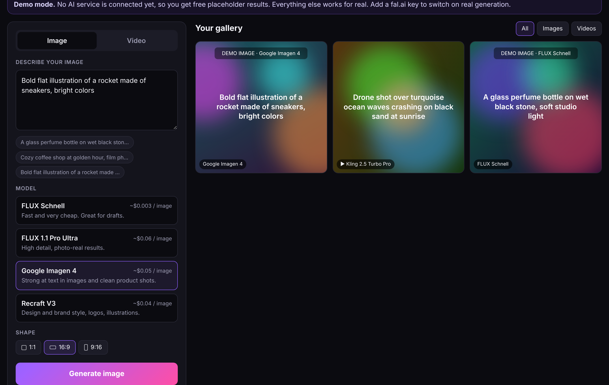

# GenStudio

Create images and videos with the best AI models, in one place.
Built for creators and marketers.



## What it does today

- **Prompt to image** with 4 models: FLUX Schnell (cheap drafts), FLUX 1.1 Pro Ultra, Nano Banana (Google), Recraft V3.
- **Prompt to video** with 3 models: Hailuo 02, Kling 2.5 Turbo Pro, Google Veo 3 Fast.
- **Auto model picking**: choose "Auto" and GenStudio picks the right model for the job (for example Nano Banana when the prompt has text, Recraft for logos, Veo 3 when a video needs sound) and says why.
- **Draft, then final**: Auto drafts with the cheapest model. Open a draft you like and press **Make final version** to re-create it with the best model. The app shows the rough cost first.
- **Ad templates**: 8 starting points for creators and marketers (product hero shot, story ad with headline, YouTube thumbnail, sale banner, product reveal video, brand teaser, UGC-style testimonial and more). Fill in a couple of blanks and go.
- Pick the shape (square, wide, tall) and the video length. Each model shows a rough price.
- **Gallery** of everything you made, saved in your browser, with download, reuse prompt, and delete.
- **Demo mode**: with no AI key, the app makes free placeholder results so you can try everything.

Accounts, payments, and a shared cloud gallery come later.

## The three modes

| Settings present | Mode | What happens |
| --- | --- | --- |
| No `FAL_KEY` | Demo | Free placeholder images and animations. |
| `FAL_KEY` but no `APP_PASSWORD` | Needs password | Real generation stays off, so strangers can't spend your credit. |
| `FAL_KEY` and `APP_PASSWORD` | Live | Real AI results. Visitors must type the password first. |

## Putting it online (Netlify)

1. Go to https://app.netlify.com and sign in (the same account you already use is fine).
2. Click **Add new project → Import an existing project → GitHub**, allow Netlify to see your repositories if it asks, and pick `genstudio`.
3. Leave every setting as it is (the `netlify.toml` file in this repo fills them in) and click **Deploy**.
4. After a minute or two you get a web address ending in `.netlify.app`. It runs in demo mode.

Every time a change is merged into `main`, Netlify updates the site by itself.

## Switching on real AI (later)

Your fal.ai key is like a credit card number. **Never paste it into chat, code, or GitHub.**
It goes only into Netlify's secret settings:

1. Create an account at https://fal.ai, add some credit, and create an API key (Dashboard → Keys).
2. In Netlify, open the `genstudio` project → **Project configuration → Environment variables** → **Add a variable**.
3. Add `FAL_KEY` with your key as the value. If Netlify asks, tick **Contains secret values**.
4. Add `APP_PASSWORD` with a password of your choice.
5. Go to **Deploys**, click **Trigger deploy → Deploy project**, and wait for it to finish.

The badge in the top right of the app turns green and says **Live**. Your browser will ask for a
username and password: type anything as the username and your `APP_PASSWORD` as the password.

### Why long videos still work on Netlify's free plan

Netlify stops any server request that runs longer than about 10 seconds, and a video can take a few
minutes. So the app never waits for the video in one request: it hands the job to fal.ai (under a second),
and the page then checks back every few seconds until the video is ready. Each check is a quick request.

## For developers

```bash
npm install
cp .env.example .env.local   # optional: add FAL_KEY and APP_PASSWORD
npm run dev                  # http://localhost:3000
```

- `lib/router.ts` holds the Auto rules; `lib/templates.ts` holds the ad templates.
- `lib/models.ts` is the model catalogue. Update model ids and prices here when fal.ai changes them.
- `app/api/generate` submits jobs to the fal.ai queue; `app/api/status` is polled until the result is ready, so long video jobs never hit Netlify's ~10 second function limit.
- `netlify.toml` holds the build settings; Netlify's Next.js runtime is added automatically.
- `proxy.ts` is the password gate. The fal.ai key is only ever used on the server.
